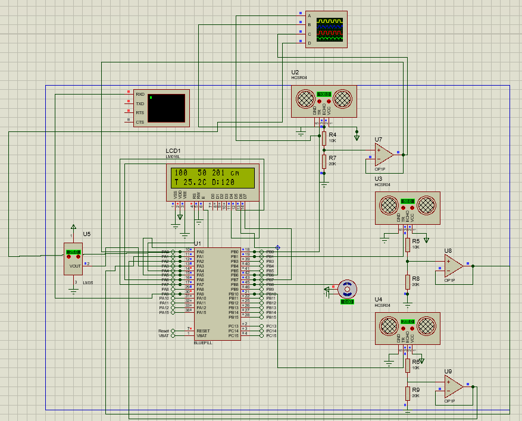
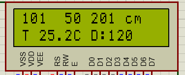
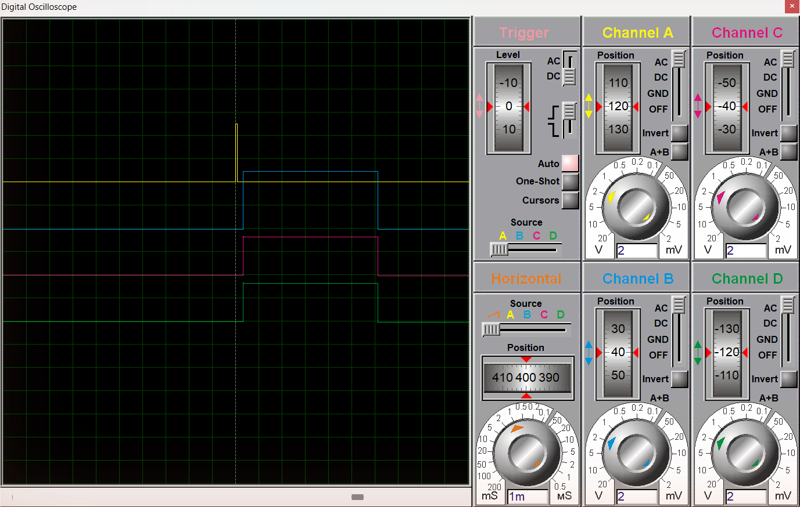
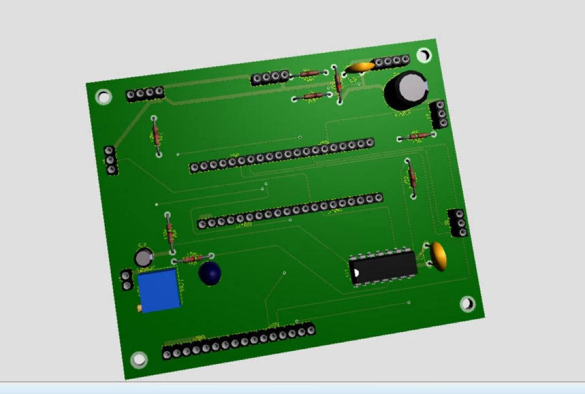

# Capteur intelligent de distance à trois voies

Capteur de distance à ultrasons sur STM32. Il mesure dans trois directions, corrige l'effet de la température, vérifie ses propres mesures et se recalibre sur commande.

Projet réalisé dans le cadre du module *Capteurs intelligents et chaînes de mesure* à l'ENSIT, 3ᵉ année ETA.



## L'idée

Un capteur classique fournit une valeur brute. Un capteur intelligent va plus loin : il sait ce qui fausse sa mesure, le corrige, et prévient quand il ne peut plus faire confiance à ce qu'il lit.

Ici, trois HC-SR04 sont placés à 0°, 120° et 240° autour d'une carte STM32F103 (BluePill). La carte cherche l'obstacle le plus proche et oriente un servomoteur dans sa direction. Le cas d'usage visé est un petit robot mobile d'intérieur.

## Fonctionnalités

| | |
|---|---|
| **Compensation en température** | La vitesse du son varie avec la température. Un LM35 la mesure et la distance est corrigée à chaque cycle. |
| **Validation des mesures** | Une valeur incohérente avec les précédentes est écartée et remplacée. |
| **Auto-diagnostic** | Chaque voie signale si elle est hors de portée, muette, bloquée ou instable. |
| **Auto-calibration** | Calibration en deux points, lancée depuis la liaison série. |
| **Gestion de l'énergie** | Veille entre deux mesures et mode éco quand la scène ne bouge pas. |
| **Communication** | Liaison série bidirectionnelle : mesures en sortie, commandes de réglage en entrée. |

## Chaîne de mesure

```
distance ─► HC-SR04 ─► adaptation 5 V → 3 V + suiveur ─► CAN 12 bits ─┐
                                                                      ├─► STM32 ─► LCD, UART, servo
température ─► LM35 ───────────────────────────────────► CAN 12 bits ─┘
```

La distance se déduit de la largeur de l'impulsion d'écho, avec une vitesse du son corrigée par la température :

```
d = t · v(T) / 2        v(T) = 331,3 + 0,606 · T
```

## Résultats

| | |
|---|---|
| Plage de mesure | 2 à 400 cm |
| Incertitude probable à 1 m | ± 4,5 mm |
| Erreur évitée par la compensation (0 à 40 °C) | jusqu'à 3,7 cm à 1 m |
| Consommation moyenne, mode normal / éco | 76 mA / 46 mA |

Les valeurs viennent de la simulation Proteus et de l'étude MATLAB. La méthode et le bilan complet sont dans le [rapport](docs/rapport_capteur_intelligent.pdf).

<p align="center">
  
  
</p>

## Commandes série

Liaison à 9600 bauds.

| Commande | Rôle |
|---|---|
| `STAT` | état de chaque voie |
| `CAL1 d`, `CAL2 d` | calibration sur deux distances connues |
| `CALRAZ` | retour aux paramètres d'origine |
| `MODE AUTO`, `MODE NORMAL`, `MODE ECO` | stratégie énergétique |
| `PER ms` | période de mesure |

## Matériel

STM32F103 BluePill, 3 × HC-SR04, LM35, LM324, LCD 16×2, servomoteur SG90.

Le PCB fait 100 × 80 mm, en deux couches. Les fichiers Proteus, les Gerber et la nomenclature sont dans [hardware/](hardware/).



## Organisation du dépôt

```
firmware/     code de la carte (Arduino IDE) et version Proteus
simulation/   projet Proteus et scripts MATLAB
hardware/     PCB, Gerber, nomenclature
docs/         rapport et captures
```

## Utilisation

**Simulation** : ouvrir `simulation/proteus/capteur_simulation.pdsprj`, coller `firmware/proteus/Main.ino` dans l'onglet *Source Code*, compiler, puis lancer.

**Carte réelle** : ouvrir `firmware/capteur_intelligent/capteur_intelligent.ino` dans Arduino IDE avec le support STM32 installé, choisir *BluePill F103C8*, puis téléverser.

**Analyse** : lancer `simulation/matlab/etude_capteur_intelligent.m`.

## Licence

MIT
