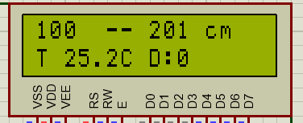
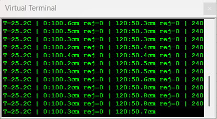
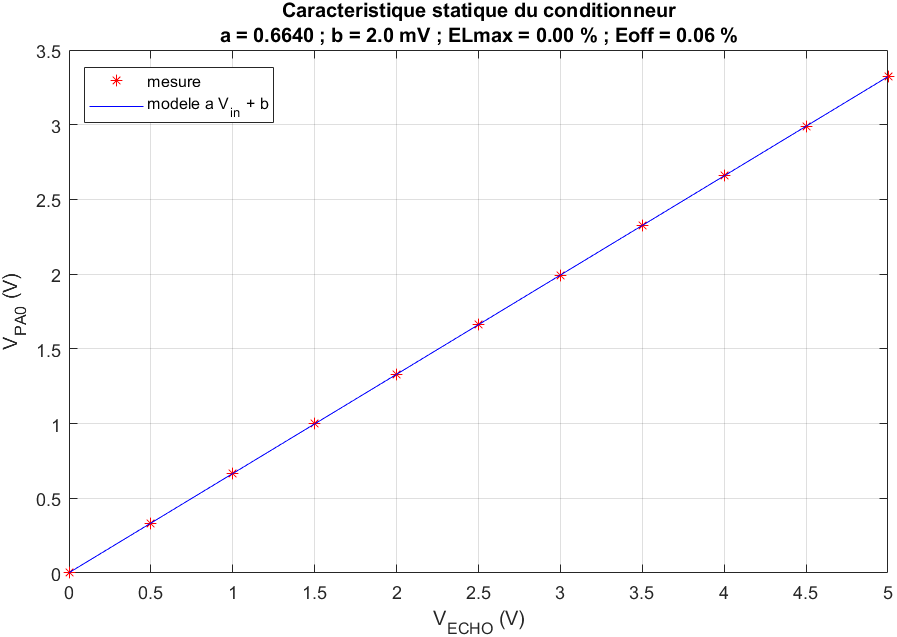
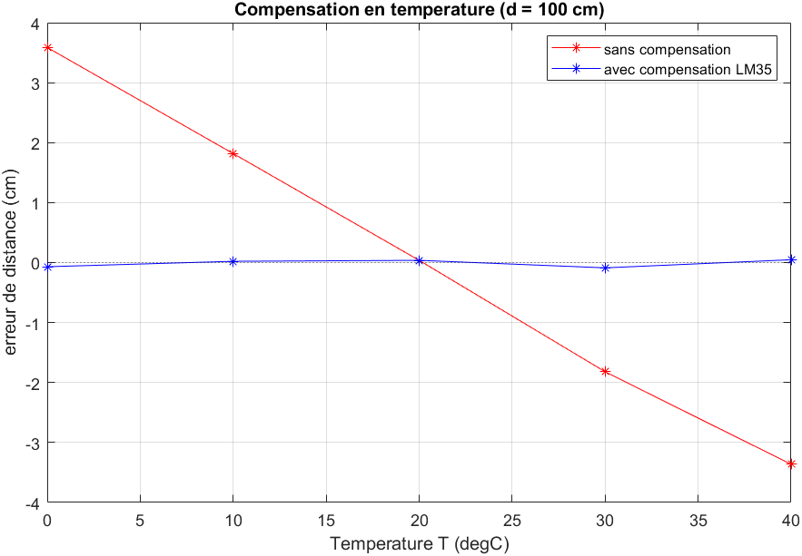

# Capteur de distance 3 voies à compensation de température

Trois HC-SR04 placés à 0°, 120° et 240° autour d'une carte STM32F103 (BluePill). La carte mesure la distance sur chaque voie, corrige la vitesse du son avec un LM35, filtre les mesures, signale un capteur en panne et oriente un servo vers l'obstacle le plus proche.

Le circuit a été simulé sous Proteus et la chaîne de conditionnement étudiée sous MATLAB. Le PCB est dessiné mais la carte n'a pas encore été fabriquée : tous les chiffres ci-dessous viennent de la simulation.


Schéma Proteus en cours de simulation, avec les HC-SR04 réglés à 100, 50 et 200 cm et le LM35 à 25 °C.

## Fonctionnement

Le HC-SR04 renvoie une impulsion ECHO dont la largeur correspond au temps aller-retour de l'onde. Cette impulsion sort en 5 V ; un pont diviseur la ramène à 3 V, puis un LM324 monté en suiveur l'envoie au CAN du STM32. Le microcontrôleur détecte les deux fronts avec un seuil placé à mi-niveau et en déduit la distance :

```
d (cm) = t (µs) × v / 20000        v = 331,3 + 0,606 × T   (m/s, T en °C)
```


Voie 0° à 100 cm, 1 ms/div et 2 V/div : TRIG sur PB0 (A), ECHO de 5 V avant le pont (B), sortie du suiveur (C) et entrée PA0 (D). L'impulsion ECHO dure environ 5,9 ms. En simulation, la sortie du suiveur et PA0 sont le même nœud, d'où des courbes C et D identiques à 3,3 V.

La température est lue sur le LM35 (10 mV/°C), moyennée sur 16 lectures. Une lecture hors de −10…60 °C est ignorée et l'afficheur le signale par un `?`.

Au démarrage, chaque voie fait 20 mesures pour vérifier que le capteur répond et estimer son bruit. Ensuite, chaque mesure passe par une moyenne glissante sur 8 valeurs ; une valeur qui s'écarte de plus de 3σ (5 cm au minimum) est rejetée, et après 3 rejets d'affilée le filtre repart de la nouvelle valeur, pour suivre un obstacle qui a vraiment bougé. Une voie qui ne répond plus 5 fois de suite passe en panne (`HS` sur l'afficheur), une voie sans obstacle entre 2 et 400 cm affiche `--`.



Le HC-SR04 de 120° est passé à 500 cm : sa voie affiche `--` et la direction retenue devient 0°, la voie valide la plus proche.

## Brochage

| Fonction | STM32 |
|---|---|
| TRIG 0°, 120°, 240° | PB0, PB1, PB10 |
| ECHO après conditionnement | PA0, PA1, PA2 |
| LM35 | PA3 |
| LCD RS, E, D4–D7 | PA4, PA5, PA6, PA7, PB6, PB7 |
| Servo | PB8 |
| UART TX, RX (9600 bauds) | PA9, PA10 |

## PCB

Carte de 100 × 80 mm, deux couches, composants traversants. La BluePill s'enfiche sur deux barrettes, les capteurs, le LCD et le servo sur des connecteurs au pas de 2,54 mm. Projet Proteus, Gerber et nomenclature dans [hardware/](hardware/).


Le pont diviseur passe de 10 k / 20 k en simulation à 10 k / 15 k sur la carte, pour sortir 3,0 V au lieu de 3,33 V et rester sous la tension maximale du CAN.

## Résultats de simulation


Distances réglées à 100, 50 et 200 cm, LM35 à 25 °C. Le LCD affiche environ 0,5 % de plus (101 et 201 cm) : le modèle HC-SR04 de Proteus convertit la distance avec une vitesse du son fixe (58 µs/cm, soit 344,8 m/s), alors que le firmware applique 346,6 m/s pour les 25,2 °C qu'il lit sur le LM35.



Trame envoyée sur l'UART à chaque cycle : température, distance filtrée et nombre de rejets par voie (la fin de ligne, avec la voie 240° et la direction, dépasse la largeur de la fenêtre du terminal).

| | |
|---|---|
| Plage de mesure | 2 à 400 cm |
| Pas du CAN | 0,806 mV (3,3 V / 4095) |
| Erreur à 1 m sans compensation, de 0 à 40 °C | jusqu'à 3,6 cm |
| Erreur à 1 m avec compensation | moins de 1 mm |
| Incertitude élargie à 1 m (k = 2) | ± 3,6 mm |

L'incertitude est dominée par la précision du HC-SR04 lui-même (± 3 mm d'après sa fiche technique). Le calcul complet est dans [docs/etude_chaine_conditionnement.pdf](docs/etude_chaine_conditionnement.pdf).

| Caractéristique du conditionneur | Effet de la compensation |
|---|---|
|  |  |

## Arborescence

```
firmware/capteur_intelligent/   firmware pour la carte (Arduino IDE + STM32duino)
firmware/proteus/               même code pour Proteus VSM
simulation/proteus/             projet de simulation
simulation/matlab/              étude de la chaîne de conditionnement
hardware/                       PCB, Gerber, nomenclature
docs/                           compte rendu de l'étude, captures
```

## Compiler et simuler

Simulation : ouvrir `simulation/proteus/capteur_simulation.pdsprj`, coller `firmware/proteus/Main.ino` dans l'onglet Source Code, compiler (F7) et lancer. Les distances et la température se règlent avec les flèches des HC-SR04 et du LM35.

Carte : dans Arduino IDE, installer *STM32 MCU based boards*, choisir *Generic STM32F1 series* puis *BluePill F103C8*, ouvrir `firmware/capteur_intelligent/capteur_intelligent.ino` et téléverser par ST-Link ou adaptateur USB-série. `SIMULATION` doit rester à 0.

MATLAB : lancer `simulation/matlab/etude_chaine_conditionnement.m` (testé sous R2023a). Le script reprend les valeurs de la simulation (pont 10 k / 20 k).

## À faire

- fabriquer et monter la carte ;
- mesurer des distances de référence à plusieurs températures et comparer avec la simulation ;
- comprendre pourquoi, dans Proteus, le firmware s'arrête après environ 3 minutes de simulation (la trame UART se coupe en pleine ligne et les TRIG ne partent plus).

## Licence

MIT
